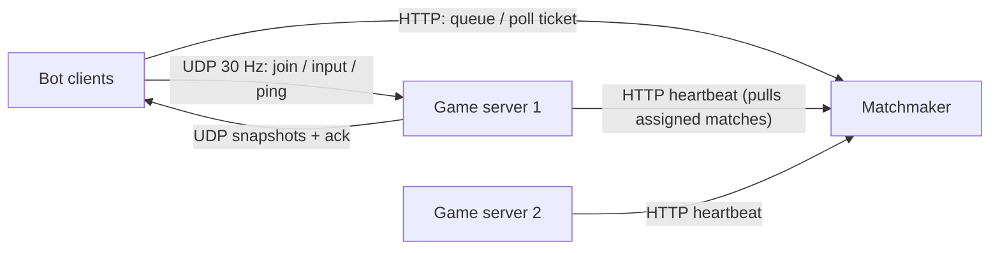

# Arena: Distributed Multiplayer Game Server & Matchmaking (C++20)

A small but real online-game backend: a **matchmaking service** that groups players by skill,
a fleet of **authoritative UDP game servers** that register with it, and **bot clients** that
play with client-side prediction and double as a load generator.



## How it works

**Matchmaker** (`src/matchmaker/`)
- `MatchQueue` keeps every ticket in three structures:
  `std::list` (arrival order, so the longest-waiting player is matched first),
  `std::multimap` keyed by skill (O(log n) range query for "players within ±window"), and
  `unordered_map` id → iterators (O(log n) cancel, no linear scan).
- The allowed skill gap **widens with wait time** (`base + rate × seconds`, capped), so players in
  sparse skill ranges still get a game. The closest candidates are chosen with `nth_element` (O(k)).
- `ServerRegistry` tracks game servers via heartbeats and places each match on the **least-loaded
  live server with free capacity**. Servers that miss heartbeats are evicted, and any match they
  never picked up is put back in the queue (players keep their original wait time).
- Pull model: servers receive their assignments in the heartbeat response, so game servers expose no
  admin port and a dead server simply stops pulling.

**Game server** (`src/gameserver/`)
- Fixed 30 Hz tick loop over a single UDP socket (`poll` + `recvfrom`).
- **Authoritative** simulation: clients send only inputs, never positions.
- Per-player **sequence numbers**: duplicate/old inputs are dropped; max 2 inputs per tick per
  player (basic speed-hack guard); only players assigned to a match can join it.
- Each player gets its own snapshot carrying `ack_seq`, which drives client reconciliation.
- Idle matches are reaped; the active-match count is reported back to the matchmaker.

**Bot client / load generator** (`src/client/bot.cpp`)
- One thread per virtual player: queue → poll ticket → join over UDP → play.
- **Client-side prediction + server reconciliation**: moves instantly using the same `proto::step`
  function as the server, then on each snapshot rewinds to the server state and replays unacked inputs.
- `--loss PCT` drops outgoing packets to simulate a bad network.
- Reports queue time, RTT (ping/pong) and average reconciliation correction.

**Wire protocol** (`src/common/protocol.hpp`): compact binary framing with a bounds-checked
reader, so truncated or malformed packets are rejected instead of read past the buffer.

## Build & run

```bash
cmake -S . -B build && cmake --build build -j
ctest --test-dir build                      # unit tests

./build/matchmaker &                        # :8080
GS_ID=gs-1 GS_PORT=7777 ./build/gameserver &
GS_ID=gs-2 GS_PORT=7778 ./build/gameserver &
./build/bot --bots 20 --seconds 10 --loss 5
curl localhost:8080/metrics
```

With Docker: `docker compose up --build`, then `docker compose --profile load up bots`.

Sanitizer build: `cmake -S . -B build-asan -DENABLE_SANITIZERS=ON` (ASan + UBSan).

### Configuration
| Variable | Service | Default |
|---|---|---|
| `PORT`, `MATCH_SIZE`, `HTTP_THREADS` | matchmaker | 8080, 2, 64 |
| `GS_ID`, `GS_HOST`, `GS_PORT`, `GS_CAPACITY` | gameserver | gs-1, 127.0.0.1, 7777, 50 |
| `MM_HOST`, `MM_PORT`, `HEARTBEAT_MS` | gameserver | 127.0.0.1, 8080, 500 |

## REST API (matchmaker)
| Method | Path | Body / result |
|---|---|---|
| POST | `/v1/queue` | `{"player_id":1,"skill":1200}` → `{"ticket_id":1}` |
| GET | `/v1/tickets/{id}` | `{"status":"waiting"}` or `{"status":"matched","match_id",...,"host","port"}` |
| DELETE | `/v1/tickets/{id}` | cancel |
| POST | `/v1/servers/heartbeat` | `{"id","host","port","capacity","active"}` → `{"assignments":[...]}` |
| GET | `/metrics`, `/healthz` | Prometheus text format, liveness |

## Load-test findings
- **HTTP worker starvation**: with the library default of 8 workers, every keep-alive bot
  connection held a thread and most of 200 bots could not even join the queue. Fixed with a
  configurable pool (`HTTP_THREADS`) and a short keep-alive timeout.
- **Listen backlog**: cpp-httplib's default `listen()` backlog of 5 dropped connections when
  hundreds of players connected at once. Raised to 1024; the bot also retries with exponential
  backoff + jitter.
- **Capacity backpressure**: when every game server is full, matches stay queued rather than
  being over-assigned; adding a server (or raising `GS_CAPACITY`) drains the queue.

## Testing
- **Unit tests (GoogleTest, 19 tests)**: queue matching, window widening, fairness, cancel,
  least-loaded placement, capacity, server eviction, replay/rate-limit rejection, arena bounds,
  per-player acks, protocol round-trip and every truncation point.
- **CI (GitHub Actions)**: normal + ASan/UBSan builds, unit tests, an end-to-end smoke test with
  two servers and lossy bots, and a Docker image build.

## Roadmap
- [ ] Java (Spring Boot) leaderboard service: Elo updates from match results, Redis sorted sets
- [ ] Prometheus + Grafana dashboard in docker-compose
- [ ] Terraform deployment to AWS (ECS/EC2), images in ECR
- [ ] Artificial latency (not just loss) in the bot, plus entity interpolation for other players
- [ ] Profile the matchmaker at 10k+ queued tickets (perf + flame graph) and compare against a naive O(n²) baseline
